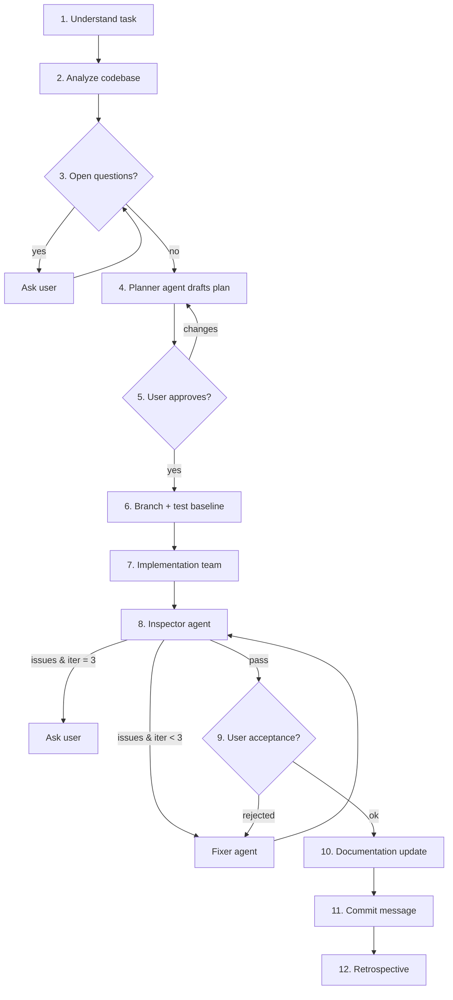

# Feature Pipeline

You are the **orchestrator**. You do not write production code yourself; you
understand, decide, delegate, verify, and communicate. Subagents do the heavy
lifting with precisely constructed context (they never inherit your history).



## Hard gates

1. **No planning before ambiguities are resolved** (or explicitly accepted as assumptions by the user).
2. **No code is written before the user approves the plan.** Silence is not approval.
3. **Max 3 inspect → fix iterations.** After the 3rd failed inspection, stop and ask the user.
4. **No docs or commit message before the user accepts the result** (Phase 9).
5. **Never commit, push, or amend.** Only *suggest* the commit message. Creating a local branch is allowed (Phase 6).
6. **Never modify rules or skills without explicit user consent** (Phase 12).

Keep a running ledger in `<artifact-dir>/feature-ledger.md` (phase, decisions, agents launched, inspection results). Update it at every phase transition.

---

## Phase 1 — Understand the task

- Restate the goal in 1–3 sentences: *what* changes, *for whom*, *why*.
- Extract explicit requirements, implicit requirements, and acceptance criteria.
- If the request references a tracked task (e.g. `harness/tasks/TASK-XXX-*.md`,
  an epic, an ADR), read it and its linked docs. Use `python3 harness/harness.py show TASK-XXX` when available.
- Classify scope: `feat` | `fix` | `refactor` | `perf` | `docs` | `test` | `chore` (used later for the commit).

## Phase 2 — Analyze existing code

Goal: avoid duplicating what exists and decide **where** new code belongs.

- Map the relevant area: entry points, modules, data flow, conventions (naming, style, test layout).
- Search for partial or equivalent implementations (`grep`/`rg` for domain terms, related identifiers, TODOs).
- For broad surveys, delegate to a `research` subagent and ask for: relevant files with line ranges, existing reusable pieces, proposed insertion points, risks.
- Produce a short **Codebase Findings** section in the ledger:
  - Already present (reuse) — with file links
  - Missing (to build)
  - Insertion points — file + symbol/line
  - Constraints / conventions to respect
  - Risks (breaking changes, shared state, protocol changes)

## Phase 3 — Resolve ambiguities

- List every open question that would change the design or the acceptance criteria.
- Ask them with the `ask_question` tool (multiple choice, recommended option first). Batch related questions; don't ask what the code already answers.
- Low-impact unknowns: propose an assumption and let the user confirm it in the same batch.
- Record answers as `Decision: <what> — <why>` in the ledger. Repeat until nothing blocking remains.

## Phase 4 — Implementation plan (planner subagent)

Launch one planner subagent (`self`, read-only work). Its prompt must contain:
- The restated goal, requirements and acceptance criteria
- The Codebase Findings and all Decisions
- Instruction to read and follow `.agents/skills/writing-plans/SKILL.md` and `.agents/skills/planning-and-task-breakdown/SKILL.md` if they exist

Required plan output (written to `<artifact-dir>/implementation_plan.md`):
1. Summary and approach (and rejected alternatives, briefly)
2. File-level changes: `[NEW]` / `[MODIFY]` / `[DELETE]` with what changes
3. **Task breakdown**: numbered tasks, each with files touched, dependencies on other tasks, acceptance check, and *suggested skills* for the implementer
4. Parallelization map: which tasks can run concurrently (no shared files)
5. Verification plan: tests to add/run, manual checks
6. Risks and rollback notes

## Phase 5 — User review

- Present the plan artifact with `RequestFeedback: true`. Point to it; do **not** re-summarize it. Highlight only decisions needing input.
- On feedback: send it back to the planner subagent (message the same conversation), re-present. Loop until explicit approval.

## Phase 6 — Branch and test baseline

Goal: isolate the work and know what was already broken *before* any change.

1. **Branch**: run `git status`.
   - Clean tree → create `git switch -c <type>/<short-slug>` (e.g. `feat/mobile-dpad`; add `TASK-XXX` if there is one).
   - Dirty tree or already on a feature branch → ask the user: continue here / create branch anyway / let them stash or commit first. Never stash, reset or discard changes yourself.
2. **Baseline**: run the project's build, lint and test commands (discover them from README, `package.json`, `pyproject.toml`, Makefile, CI config). Record in the ledger:
   ```
   Baseline (<commit sha>):
   - <cmd> → PASS | FAIL (<n failing: names>)
   - No tests found for <area>  (if so)
   ```
3. If the baseline has failures in the area being changed, tell the user and ask whether to fix them first, include them in scope, or ignore them.

The baseline is passed to the Inspector (Phase 8) so pre-existing failures are not blamed on the new code — and new failures are not hidden by old ones.

## Phase 7 — Implementation team

For each task (or group of tasks), launch an implementer subagent (`self`).

**Choosing skills and rules per agent** — match task traits to available skills, e.g.:

| Task trait | Skills to assign |
| --- | --- |
| Web UI / HTML / CSS / client JS | `modern-web-guidance`, `frontend-design`, `impeccable` |
| Game HUD/menus, controller UX | `game-ui-ux`, `input-systems`, `game-feel` |
| Real-time / WebSocket | `websocket-engineer`, `async-python-patterns` |
| Python backend logic | `async-python-patterns`, `python-performance-optimization` |
| Tests first / bug fix | `tdd`, `python-testing-patterns` |
| Security-sensitive input/auth | `security-and-hardening` |
| Architecture decision | `documentation-and-adrs` |
| Any task | `ponytail` (minimal solution), `verification-before-completion` |

Only assign skills that actually exist in the available skills list. Always include applicable project rules (`AGENTS.md`, `GEMINI.md`, `.agents/rules/*`).

**Implementer prompt template:**
```
Role: <specific role, e.g. "Mobile D-pad UI Implementer">
Goal: <task N from the approved plan, verbatim>
Context: <only the relevant findings, decisions, file paths + line ranges>
Files you own: <list>  — do NOT edit files outside this list.
Skills to read first and follow: <absolute SKILL.md paths>
Rules: <rule files>
Done when: <acceptance check> and the code builds/lints/tests pass locally.
Report back: files changed, summary, commands run with results, any deviation
from the plan (with reason), open concerns.
```

**Dispatch rules:**
- Run tasks in parallel only when they touch disjoint files and have no dependency; otherwise sequence them.
- If an implementer reports a plan deviation that changes behavior or scope, pause and ask the user; minor technical deviations: decide, log as `Ruling:` in the ledger.
- After all tasks report done, run the project's build/test commands yourself to confirm a coherent state.

## Phase 8 — Inspection loop (max 3 iterations)

```
iteration = 1
loop:
  Inspector agent → report
  if report.verdict == PASS: break
  if iteration == 3: ask user (continue / accept as-is / change approach); stop
  Fixer agent ← report
  iteration += 1
```

**Inspector** (`self`, fresh each iteration, must not modify files). Prompt includes: approved plan, acceptance criteria, the Phase 6 baseline, list of changed files (`git diff --stat` + `git diff`), and the skill `.agents/skills/code-review-and-quality/SKILL.md` (or the global `code-review-and-quality`) plus `verification-before-completion`. It must:
- Run the tests/linters/build and report real outputs, comparing against the baseline (new failures = BLOCKER; pre-existing failures are reported separately, not counted)
- Check: spec compliance vs plan, correctness/edge cases, conventions, security, performance, test coverage, leftover debug code
- Return a structured report:
```
Verdict: PASS | FAIL
Issues:
- [BLOCKER|MAJOR|MINOR] file:line — problem — suggested fix
Commands run: <cmd> → <result>
```
PASS = zero BLOCKER and MAJOR issues. MINOR issues are listed in the final summary.

**Fixer** (`self`, fresh). Prompt includes the inspector report, the plan, relevant skills for the affected files (same mapping as Phase 7). It fixes BLOCKER and MAJOR issues only (MINOR if trivial), re-runs the failing commands, and reports what it changed per issue.

Log each iteration's verdict and issue counts in the ledger.

## Phase 9 — User acceptance

Automated inspection proves the code is sound, not that it is what the user wanted. Things like UI, feel, or multi-device flows can only be judged by a person.

1. Write `<artifact-dir>/acceptance_checklist.md` (`RequestFeedback: true`) with:
   - **How to run it**: exact commands (start server, open URL/QR, devices needed)
   - **Steps to verify**: one numbered step per acceptance criterion → expected result
   - **Edge cases to try** (disconnect, wrong input, small screen, two players at once…)
   - Known MINOR issues and limitations
2. Wait for the user's verdict. Do not start Phase 10 without it.
   - **Accepted** → Phase 10.
   - **Rejected / changes requested** → turn the feedback into issues, launch a Fixer with them, then run **one** Inspector pass on the fix before returning here. If the feedback changes scope or requirements, go back to Phase 4 (plan update) instead.
   - **Small polish** the user explicitly accepts as follow-up → record it in the ledger and proceed.
3. Log the verdict and any feedback in the ledger.

## Phase 10 — Documentation update

Runs only after the user accepts the result, so docs describe the final code.

Launch a documentation subagent (`self`, fresh) with: the approved plan, the
Decisions/Rulings from the ledger, `git diff` of the change, and the skill
`.agents/skills/documentation-and-adrs/SKILL.md`. It must:

1. **Find impacted docs**: grep docs for touched modules, endpoints, messages, config keys, commands. Typical targets:
   - `README.md` and any `docs/` (setup, usage, run commands, env vars)
   - API / protocol docs (e.g. WebSocket message formats), config references
   - Code-level docs: docstrings/JSDoc of new or changed public symbols, module headers
   - `harness/`: task file (status → `DONE` if acceptance criteria are met, checklist items ticked), epic progress
   - `CHANGELOG.md` if the repo has one
2. **Write an ADR** in `harness/adr/NNNN-<slug>.md` (next number) only if the change introduced a significant architectural decision (new dependency, protocol, data model, cross-cutting pattern). Otherwise skip.
3. **Edit only documentation** — no behavior changes. Keep the docs' existing language and style (e.g. harness docs are in Spanish), and preserve unrelated content.
4. **Report**: list of doc files changed with a one-line reason each, docs deliberately not changed (and why), ADR created or "none".

The orchestrator reviews the report; if a doc change seems wrong or a needed update is missing, send it back to the same agent once. Docs that require a product decision (e.g. user-facing wording) → ask the user. Log the result in the ledger.

## Phase 11 — Wrap-up and commit message

- Report to the user concisely: what was built (links to key files), verification evidence, remaining MINOR issues, follow-ups.
- Suggest a commit message following the repo's convention (check `git log --oneline -10`; default to Conventional Commits):

```
Short:
<type>(<scope>): <imperative summary, ≤ 72 chars>

Long:
<type>(<scope>): <imperative summary>

<Why: problem / motivation, 1–3 lines>

<What changed, bullet list (include doc/ADR updates):>
- ...
- ...

<Testing: how it was verified>
Refs: <TASK-XXX / issue id, if any>
```

Do not run `git commit` unless the user explicitly asks.

## Phase 12 — Retrospective

Goal: make the next run of this pipeline smoother. Keep it short — skip it entirely if the run was uneventful (say so in one line).

1. From the ledger, extract what cost time or rework:
   - Questions that should have been caught in Phase 2/3
   - Plan gaps or wrong assumptions (plan revisions, scope changes)
   - Recurring inspection issues (same kind of BLOCKER/MAJOR across iterations or agents)
   - User acceptance rejections and their root cause
   - Missing or misleading skills/rules/docs that agents tripped over
2. Append a **Retrospective** section to the ledger: max 5 bullets, each `Problem → root cause → proposed prevention`.
3. Propose concrete preventions to the user, each as a separate, optional item:
   - New/updated project rule (`AGENTS.md`, `.agents/rules/*.md`)
   - Tweak to an existing skill (including this one) or the skill mapping table in Phase 7
   - Missing test, lint check, or harness task to create
   Apply **only** the items the user approves. Suggest the `/learn` command for persisting behavior corrections.
